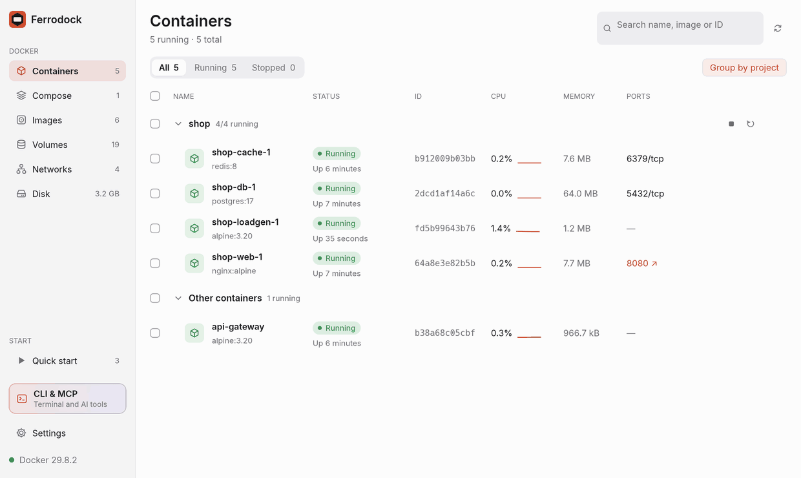
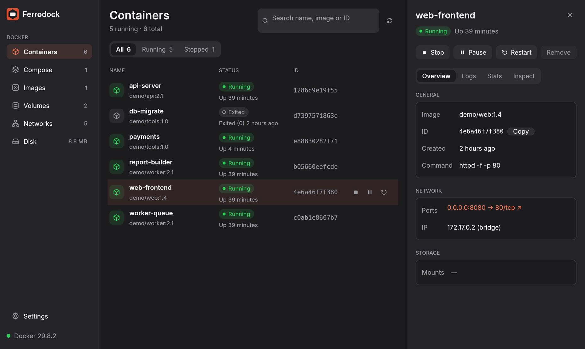
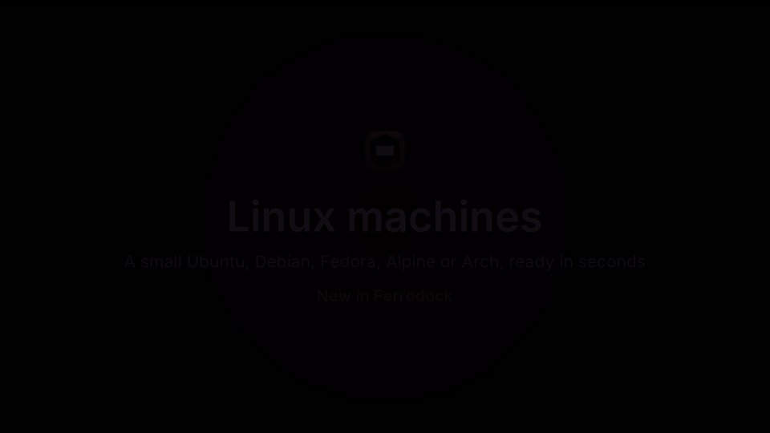

<div align="center">


# Ferrodock

**The native container manager, written in Rust**<br>
One free app for macOS, Windows and Linux, with its own Docker engine built in:<br>
containers, images, volumes, networks and Compose, plus a CLI and an MCP server for AI tools.

[](https://github.com/manimovassagh/Ferrodock/releases/latest)
[](https://github.com/manimovassagh/Ferrodock/actions/workflows/ci.yml)
[](https://scorecard.dev/viewer/?uri=github.com/manimovassagh/Ferrodock)
[](https://crates.io/crates/ferrodock)
[](LICENSE)
[](https://www.rust-lang.org)

**[Download](https://github.com/manimovassagh/Ferrodock/releases/latest)** ·
**[Website](https://manimovassagh.github.io/Ferrodock/)** ·
**[Documentation](https://manimovassagh.github.io/Ferrodock/docs)**



</div>

Ferrodock is a single native app: no Electron, no web view, and no CPU used
while idle. It brings **its own Docker engine** on every platform (a
lightweight VM on Macs, a WSL distro on Windows, a service on Linux), so
there's nothing else to install, and your images, Compose files and
`docker` commands keep working. Already run Docker? Ferrodock connects to
that instead.

## Highlights

- **Containers** with live CPU and memory, one-click start / stop / pause /
  restart, clickable ports, bulk actions, and grouping by Compose project.
- **Logs, stats, terminal and files**: colourful, searchable live logs;
  CPU and memory charts; a real shell inside any container (even ones
  without a shell); and a file browser with upload and download.
- **Compose**: start a project from its `compose.yaml`, rebuild services,
  and read every service's logs together.
- **Images**: search Docker Hub as you type, pull with progress, run with a
  form that shows the `docker run` command, and tag, push, save or load.
- **Quick start**: Postgres, MySQL, Redis, MongoDB, RabbitMQ, MinIO, Mailpit
  or Nginx in one click, with the connection string ready to copy.
- **Linux machines**: a small Ubuntu, Debian, Fedora, Alpine or Arch Linux
  to work in, with your user, `sudo` and a folder shared from your computer.
- **Volumes and networks**: create them, browse a volume's files, connect
  and disconnect containers.
- **Disk**: see where the space goes and free it in one step, with a preview
  of exactly what's deleted. Or start over with **Reset Docker**.
- **Command palette** (⌘K / Ctrl+K) and keyboard shortcuts for everything.
- **Any engine**: Ferrodock's own, a local `dockerd`, or any Docker context,
  including remote ones over TLS or SSH. Switch from the sidebar.
- **At home on your desktop**: light and dark themes, a menu bar /
  notification area icon, crash notifications, launch at login, and
  one-click updates.

<table>
  <tr>
    <td></td>
    <td></td>
  </tr>
  <tr>
    <td></td>
    <td></td>
  </tr>
</table>

## Install

**Easiest:** ask your AI assistant (Claude Code, Codex, Copilot, Cursor…)
*"Install Ferrodock for me, following
https://manimovassagh.github.io/Ferrodock/install.md"*. It follows the
[install skill](skills/install-ferrodock/SKILL.md): official download,
checksum checked, and it asks before anything that needs your password.

**macOS** (with [Homebrew](https://brew.sh)):

```bash
brew tap manimovassagh/ferrodock https://github.com/manimovassagh/Ferrodock
brew install --cask ferrodock
```

Or download a build from the
**[latest release](https://github.com/manimovassagh/Ferrodock/releases/latest)**:

| Platform | Download | First launch |
|---|---|---|
| **macOS** 11+, Apple Silicon and Intel | `Ferrodock-<version>-macos-universal.dmg` (or `.zip`) | Drag **Ferrodock.app** to Applications. It isn't notarized yet, so allow it once with **Open Anyway** in System Settings → Privacy & Security (Homebrew does this for you). |
| **Windows** 10 / 11, x64 | `Ferrodock-<version>-windows-x64.zip` | Unzip and run **Ferrodock.exe**. If SmartScreen appears, choose **More info → Run anyway**. |
| **Linux** x64 | `Ferrodock-<version>-linux-x64.tar.gz` | `tar -xzf Ferrodock-*.tar.gz && ./ferrodock` |

Each release has a `SHA256SUMS.txt` to check your download. Ferrodock
updates itself: when a new version is out, click **Update to x.y.z** in the sidebar
(or run `brew upgrade --cask ferrodock`).

The [installation guide](https://manimovassagh.github.io/Ferrodock/docs/installation)
has the details for each platform.

## Linux machines

Need a quick Ubuntu to try something in? The **Linux machines** page makes
a small Ubuntu, Debian, Fedora, Alpine or Arch Linux in one click, with your
user, `sudo`, git and an editor ready. Share a folder from your computer and
the shell starts right in it: files you make there are on your computer too.
On Apple Silicon Macs, machines run the native arm64 build of each
distribution.

<a href="website/static/video/linux-machines.mp4"></a>

[Watch it as a video](website/static/video/linux-machines.mp4) ·
[Read more](https://manimovassagh.github.io/Ferrodock/docs/using/linux-machines)

## How it compares

| | Ferrodock | Docker Desktop | OrbStack | Rancher Desktop | Podman Desktop |
| --- | --- | --- | --- | --- | --- |
| macOS, Windows and Linux | ✅ | ✅ | macOS only | ✅ | ✅ |
| App built with | Rust, native | Electron | Swift, native | Electron | Electron |
| Docker engine included | ✅ | ✅ | ✅ | ✅ | Podman |
| Open source | ✅ MIT | ❌ | ❌ | ✅ Apache-2.0 | ✅ Apache-2.0 |
| CLI and MCP server for AI tools, built in | ✅ | MCP Toolkit | ❌ | ❌ | ❌ |
| Linux machines to work in | ✅ | ❌ | ✅ | ❌ | ❌ |

## Ferrodock's own engine

When Ferrodock finds no Docker engine, click **Set up Ferrodock's engine**.
It downloads the engine once, and from then on it starts and stops with
Ferrodock.

- **Macs** (Apple Silicon and Intel): a small Linux VM with the Docker
  engine, run through Apple's Virtualization framework. Your home folder is
  shared, so bind mounts just work. On Apple Silicon, Intel-only
  (`linux/amd64`) images run too, through Rosetta.
- **Windows**: a WSL distro called `ferrodock`. WSL is part of Windows; if
  it's missing, Ferrodock installs it (with an administrator prompt).
- **Linux**: the Docker engine itself, as a system service. Setting it up
  asks for your admin password once; then it starts with your computer.

Already run Docker somewhere? Ferrodock connects to it through
`DOCKER_HOST` or your Docker contexts. See
[Ferrodock's own engine](https://manimovassagh.github.io/Ferrodock/docs/engine)
and [Connecting to other engines](https://manimovassagh.github.io/Ferrodock/docs/engines).

## Command line and AI tools

Ferrodock comes with two more programs, built on the same Rust core:

- **`fdock`**, the command line: `fdock ps`, `fdock logs web -f`,
  `fdock quickstart postgres`, `fdock df` and more. Every command takes
  `--json` for compact output that scripts and AI tools read cheaply.
- **`ferrodock-mcp`**, an [MCP](https://modelcontextprotocol.io) server, so
  AI tools can list containers, read logs, start services and clean up.
  Tools that change something ask first; `--read-only` leaves them out.

  ```bash
  claude mcp add ferrodock -- ferrodock-mcp
  ```

Ferrodock puts both on your PATH: by itself on Windows and Linux, and with
one click under **CLI & MCP** in the sidebar on macOS (Homebrew does it too). See [Command line and AI tools](https://manimovassagh.github.io/Ferrodock/docs/cli-and-mcp).

## Documentation

Everything else lives on the **[documentation site](https://manimovassagh.github.io/Ferrodock/docs)**:
[getting started](https://manimovassagh.github.io/Ferrodock/docs/installation),
[using Ferrodock](https://manimovassagh.github.io/Ferrodock/docs/category/using-ferrodock),
[updates and releases](https://manimovassagh.github.io/Ferrodock/docs/releases)
and [troubleshooting](https://manimovassagh.github.io/Ferrodock/docs/troubleshooting).
What changed in each version is in [CHANGELOG.md](CHANGELOG.md).

## Build from source

You need [Rust](https://rustup.rs) 1.95 or newer (on macOS, also run
`xcode-select --install` once; on Windows, let the Rust installer set up the
Visual Studio C++ Build Tools).

```bash
git clone https://github.com/manimovassagh/Ferrodock.git
cd Ferrodock
cargo run --release
```

`cargo install ferrodock` works too. On macOS, `packaging/macos/bundle.sh`
builds a universal `Ferrodock.app`.

## Contributing

Bug reports, ideas and pull requests are welcome: start with an
[issue](https://github.com/manimovassagh/Ferrodock/issues/new/choose), and
see [CONTRIBUTING.md](CONTRIBUTING.md) for the development setup and
guidelines. Releases are automated; [RELEASING.md](RELEASING.md) explains
how. Please report security issues privately, as described in
[SECURITY.md](SECURITY.md).

## Author

Created and maintained by **Mani Movassagh**
([@manimovassagh](https://github.com/manimovassagh)).

## License

Ferrodock is released under the [MIT License](LICENSE). It's free to use for
personal, commercial and organisational projects, with no account,
subscription or fee. Every dependency is under a permissive open source
license, checked in CI. Ferrodock's own engine is built only from free and
open source software: see [engine/NOTICE.md](engine/NOTICE.md).
