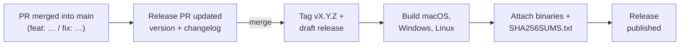

<div align="center">


# Ferrodock

**A fast, native desktop app for managing Docker, written entirely in Rust.**

[](https://github.com/manimovassagh/Ferrodock/actions/workflows/ci.yml)
[](https://github.com/manimovassagh/Ferrodock/releases/latest)
[](LICENSE)
[](https://www.rust-lang.org)

Windows · macOS · Linux · **[Documentation](https://manimovassagh.github.io/Ferrodock/)**


</div>

Ferrodock gives you a clean, responsive view of everything in your Docker
Engine: containers with their live logs and stats, Compose projects, images,
volumes and networks. It's a single native executable with no Electron, no
web view and no background service. It talks straight to the Docker Engine
API, uses no CPU while idle, and stays out of your way.

## Download

Grab the latest build from the
**[Releases page](https://github.com/manimovassagh/Ferrodock/releases/latest)**:

| Platform | File | First launch |
|---|---|---|
| **macOS** 11+ (Apple Silicon and Intel) | `Ferrodock-…-macos-universal.dmg` (or `.zip`) | Open the DMG and drag **Ferrodock.app** to Applications. The app isn't notarized yet, so allow it once: run `xattr -dr com.apple.quarantine /Applications/Ferrodock.app`, or click **Open Anyway** in System Settings → Privacy & Security. |
| **Windows** 10/11 (x64) | `Ferrodock-…-windows-x64.zip` | Unzip and run **Ferrodock.exe**. If SmartScreen appears, choose **More info → Run anyway**. |
| **Linux** (x64) | `Ferrodock-…-linux-x64.tar.gz` | Extract and run `./ferrodock`. |

On macOS you can also install with [Homebrew](https://brew.sh):

```bash
brew tap manimovassagh/ferrodock https://github.com/manimovassagh/Ferrodock
brew install --cask ferrodock
```

Ferrodock needs a running Docker Engine: Docker Desktop, Colima, Rancher
Desktop, or a native `dockerd`.

Every release also has a `SHA256SUMS.txt`. To check that a download is
intact, run this in the folder you downloaded to:

```bash
shasum -a 256 -c SHA256SUMS.txt --ignore-missing      # macOS
sha256sum -c SHA256SUMS.txt --ignore-missing          # Linux
Get-FileHash .\Ferrodock-*-windows-x64.zip            # Windows (compare with SHA256SUMS.txt)
```

## Features

- **Containers**: status, image, ID, live CPU and memory, and ports at a
  glance. Start, stop,
  pause, restart and remove with one click, and open published ports in
  your browser. Filter by All / Running / Stopped.
- **Logs**: the last 500 lines, then live output as it happens, with a
  filter and copy.
- **Stats**: live CPU and memory charts, plus network and disk totals.
- **Inspect**: environment variables (secrets hidden until you ask),
  labels, restart policy, health checks and the raw JSON for anything.
- **Compose**: containers grouped by Docker Compose project. Start, stop,
  restart or remove a whole project at once.
- **Pull and run images**: pull with a progress bar, and start a container
  from any image with a form for ports, environment, volumes and restart
  policy. It shows the equivalent `docker run` command as you type.
- **Quick start**: run Postgres, MySQL, Redis, MongoDB, RabbitMQ, MinIO,
  Mailpit or Nginx with local-development settings, and copy the connection
  string. Also reachable from the menu bar, or with **Run…** on a Docker Hub
  search result.
- **Images, Volumes, Networks**: size, mountpoints, subnets, and which
  containers use each one.
- **Disk**: see where the space goes (images, containers, volumes, build
  cache) and free it in one step, with a preview of exactly what's deleted.
- **Clean up**: remove single items or everything unused, always with a
  confirmation first.
- **Command palette** (⌘K / Ctrl+K) and keyboard shortcuts for every
  action: jump to any container, image or volume, or run an action, without
  touching the mouse.
- **Search** on every page, and **instant updates** from Docker's event
  stream, with an alert when a container crashes or runs out of memory.
- **In-app updates**: one click downloads, verifies and installs a new
  version, then restarts.
- **Settings** for theme (light, dark or follow the system), compact rows and
  interface size, remembered between runs.
- **Resilient**: start Ferrodock before Docker and it connects as soon as the
  engine is up.
- **Light on resources**: Docker calls run on a background thread so the UI
  never blocks, and logs and stats only stream for the container you're
  looking at.

<table>
  <tr>
    <td></td>
    <td></td>
  </tr>
  <tr>
    <td></td>
    <td></td>
  </tr>
</table>

## Build from source

You need [Rust](https://rustup.rs) 1.95 or newer. On macOS, also run
`xcode-select --install` once. On Windows, let the Rust installer set up the
Visual Studio C++ Build Tools.

```bash
git clone https://github.com/manimovassagh/Ferrodock.git
cd Ferrodock
cargo run --release
```

On macOS, `packaging/macos/bundle.sh` builds a universal `Ferrodock.app`.

### Connecting to a different engine

Ferrodock uses the platform default (`/var/run/docker.sock`, or the
`\\.\pipe\docker_engine` named pipe on Windows) unless `DOCKER_HOST` is set:

```bash
# Docker Desktop on macOS with the default socket turned off
DOCKER_HOST=unix://$HOME/.docker/run/docker.sock ferrodock

# Colima
DOCKER_HOST=unix://$HOME/.colima/default/docker.sock ferrodock
```

## Architecture

Ferrodock is 100% Rust: [egui/eframe](https://github.com/emilk/egui) for the
native UI, [bollard](https://github.com/fussybeaver/bollard) for the Docker
Engine API and [tokio](https://tokio.rs) for async I/O.

```
src/
├── main.rs            window setup
├── docker/            Docker Engine API, one file per resource (no UI code)
├── worker/            background thread: Docker calls, log and stats streams
├── theme/             colour palettes, widget styling, fonts
└── app/
    ├── mod.rs         wires the store, the shell and the pages together
    ├── store/         everything currently known about the engine
    ├── page.rs        the Page trait every sidebar section implements
    ├── pages/         containers · compose · images · volumes · networks
    ├── components/    table, details pane, dialogs, charts, toasts
    ├── shell.rs       shared page header and "Docker isn't running" screen
    └── sidebar.rs
```

**How data flows:** the UI sends requests to the worker over a channel. The
worker calls the Docker Engine and sends the results back into the `Store`.
Pages only read from the store. When a page wants something done, it returns
an *intent* (run an action, or ask for confirmation first) and the app passes
it on to the worker.

**Adding a page:** implement the `Page` trait in a new file under
`src/app/pages/` and add one line to `pages::all()`. The sidebar, header,
search and details pane work automatically.

## Releases and release notes

- **What's new:** every release on the
  [Releases page](https://github.com/manimovassagh/Ferrodock/releases) has
  release notes listing what was added, fixed and changed. The full history
  is in [CHANGELOG.md](CHANGELOG.md).
- **What a release contains:** ready-to-run builds for macOS (universal),
  Windows and Linux, plus `SHA256SUMS.txt`.
- **Version numbers** follow [Semantic Versioning](https://semver.org).
  Before 1.0, a minor bump (0.3 → 0.4) means new features or breaking
  changes, and a patch bump (0.3.0 → 0.3.1) means fixes only. Breaking
  changes are marked **breaking** in the notes.
- **Pre-releases** (e.g. `1.0.0-rc.1`) are marked as such on GitHub, and
  are never shown as the latest release.

### How a release is made

Releases are fully automated with
[release-plz](https://release-plz.dev) and GitHub Actions. Nobody edits
version numbers or the changelog by hand.



1. Pull requests are squash-merged with
   [Conventional Commit](https://www.conventionalcommits.org) titles:
   `feat: …` for features, `fix: …` for bug fixes. The title becomes the
   changelog entry.
2. release-plz keeps a **release PR** open with the next version number and
   the changelog for it.
3. Merging that PR tags the release and creates a **draft**. Builds for
   every platform are attached together with checksums, and only then is it
   published, so a release never appears without its downloads.

The details, including pre-releases and rebuilding a release's downloads,
are in [RELEASING.md](RELEASING.md).

## Contributing

Contributions are welcome! Planned work and ideas live in
[issues](https://github.com/manimovassagh/Ferrodock/issues); to suggest
something, [open a feature request](https://github.com/manimovassagh/Ferrodock/issues/new/choose).
See [CONTRIBUTING.md](CONTRIBUTING.md) for the
development setup and guidelines, [CHANGELOG.md](CHANGELOG.md) for what's
changed, and [RELEASING.md](RELEASING.md) for how releases are made. Please
report security issues privately as described in [SECURITY.md](SECURITY.md).

## Author

Created and maintained by **Mani Movassagh**
([@manimovassagh](https://github.com/manimovassagh)).

## License

Ferrodock is released under the [MIT License](LICENSE). It's free to use for
personal, commercial and organisational projects.
