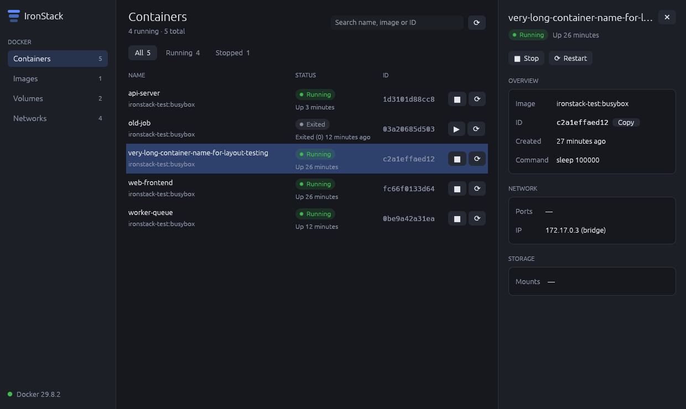
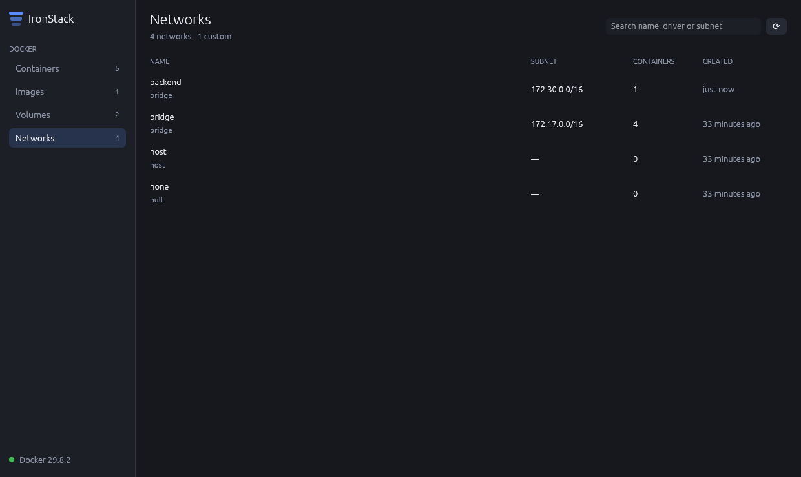

<div align="center">

# IronStack

**A fast, native desktop app for managing Docker, written entirely in Rust.**

Windows-first · runs on macOS and Linux · MIT licensed


</div>

---

IronStack gives you a clean, responsive view of everything running in your
Docker Engine: containers, images, volumes and networks. It's a single native
executable with no Electron, no web view and no background services. It talks
straight to the Docker Engine API and stays out of your way.

## Features

- **Containers**: see every container with its status, image, ID and ports.
  Start, stop and restart with one click. Filter by All / Running / Stopped.
- **Images**: tags, size, age, and which containers use each image.
- **Volumes**: driver, mountpoint, and which containers mount each volume.
- **Networks**: subnet, gateway, driver, and the containers attached.
- **Details pane**: click any row for everything about that item, with
  one-click copy for IDs.
- **Search** on every page, plus **live updates** every few seconds.
- **Light and dark themes** that follow your system setting.
- **Resilient**: start IronStack before Docker and it connects automatically
  as soon as the engine is up.
- **Fast**: all Docker calls run on a background thread, so the UI never
  blocks. It uses almost no CPU while idle.

<table>
  <tr>
    <td></td>
    <td></td>
  </tr>
  <tr>
    <td></td>
    <td></td>
  </tr>
</table>

## Getting started

### Requirements

- A running Docker Engine: **Docker Desktop** on Windows or macOS, or any
  other engine (Colima, Rancher Desktop, native `dockerd`, …).
- **Rust 1.95 or newer** to build from source. Install it from
  [rustup.rs](https://rustup.rs).

### Windows

1. Install [Rust](https://rustup.rs). When asked, let it install the Visual
   Studio C++ Build Tools.
2. Build and run:

   ```powershell
   git clone https://github.com/manimovassagh/IronStack.git
   cd IronStack
   cargo run --release
   ```

IronStack connects to Docker Desktop through the standard
`\\.\pipe\docker_engine` named pipe. The release build is a GUI app with no
console window. You'll find it at `target\release\ironstack.exe`.

### macOS

```bash
xcode-select --install                                         # Apple build tools (once)
curl --proto '=https' --tlsv1.2 -sSf https://sh.rustup.rs | sh # Rust (once)

git clone https://github.com/manimovassagh/IronStack.git
cd IronStack
cargo run --release
```

### Linux

```bash
git clone https://github.com/manimovassagh/IronStack.git
cd IronStack
cargo run --release
```

Your user needs access to the Docker socket (usually by being in the `docker`
group).

### Connecting to a different engine

IronStack uses the platform default (`/var/run/docker.sock`, or the named pipe
on Windows) unless `DOCKER_HOST` is set:

```bash
# Docker Desktop on macOS with the default socket turned off
DOCKER_HOST=unix://$HOME/.docker/run/docker.sock cargo run --release

# Colima
DOCKER_HOST=unix://$HOME/.colima/default/docker.sock cargo run --release
```

## Architecture

IronStack is 100% Rust, built on [egui/eframe](https://github.com/emilk/egui)
for the native UI, [bollard](https://github.com/fussybeaver/bollard) for the
Docker Engine API, and [tokio](https://tokio.rs) for async I/O.

```
src/
├── main.rs              window setup
├── theme.rs             colour palettes, spacing, fonts
├── worker.rs            background thread: runs Docker calls off the UI thread
├── docker/              Docker Engine API, one file per resource
│   ├── containers.rs
│   ├── images.rs
│   ├── volumes.rs
│   ├── networks.rs
│   └── format.rs        sizes and "3 hours ago" style times
└── app/
    ├── mod.rs           wires the store, the shell and the pages together
    ├── store.rs         everything currently known about the engine
    ├── page.rs          the Page trait every sidebar section implements
    ├── pages/           containers · images · volumes · networks
    ├── components/      reusable widgets, table, details pane, toast
    ├── shell.rs         shared page header and "Docker isn't running" screen
    └── sidebar.rs
```

**How data flows:** the UI sends requests to the worker over a channel. The
worker calls the Docker Engine and sends results back, and they land in the
`Store`. Pages read from the store and never talk to Docker directly. When a
page wants something done (say, stop a container), it returns an *intent* and
the app forwards it to the worker.

**Adding a page:** implement the `Page` trait in a new file under
`src/app/pages/` and add one line to `pages::all()`. The sidebar, header,
search and details pane work automatically.

## Development

```bash
cargo run                         # debug build
cargo test                        # unit tests
cargo test -- --include-ignored   # also run tests against a live Docker Engine
cargo clippy --all-targets        # lints
cargo fmt                         # formatting
```

Cross-compiling a Windows build from Linux:

```bash
rustup target add x86_64-pc-windows-gnu
sudo apt install gcc-mingw-w64-x86-64
cargo build --release --target x86_64-pc-windows-gnu
```

## Roadmap

- [ ] Remove containers, images, volumes and networks; clean up unused items
- [ ] Container logs and live CPU / memory stats
- [ ] Prebuilt downloads for Windows and macOS
- [ ] Docker Compose projects

## License

IronStack is released under the [MIT License](LICENSE). You're free to use it
for personal, commercial and organisational projects.
