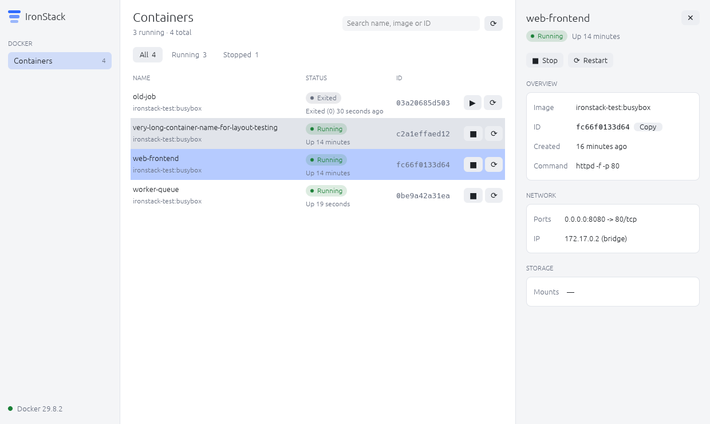

<div align="center">


# IronStack

**A fast, native desktop app for managing Docker, written entirely in Rust.**

[](https://github.com/manimovassagh/IronStack/actions/workflows/ci.yml)
[](https://github.com/manimovassagh/IronStack/releases/latest)
[](LICENSE)
[](https://www.rust-lang.org)

Windows · macOS · Linux · **[Documentation](https://manimovassagh.github.io/IronStack/)**


</div>

IronStack gives you a clean, responsive view of everything in your Docker
Engine: containers, images, volumes and networks. It's a single native
executable with no Electron, no web view and no background service. It talks
straight to the Docker Engine API and stays out of your way.

## Download

Grab the latest build from the
**[Releases page](https://github.com/manimovassagh/IronStack/releases/latest)**:

| Platform | File | First launch |
|---|---|---|
| **macOS** 11+ (Apple Silicon and Intel) | `IronStack-…-macos-universal.zip` | Unzip, move **IronStack.app** to Applications, then **right-click → Open** once (the app isn't notarized yet). |
| **Windows** 10/11 (x64) | `IronStack-…-windows-x64.zip` | Unzip and run **IronStack.exe**. If SmartScreen appears, choose **More info → Run anyway**. |
| **Linux** (x64) | `IronStack-…-linux-x64.tar.gz` | Extract and run `./ironstack`. |

IronStack needs a running Docker Engine: Docker Desktop, Colima, Rancher
Desktop, or a native `dockerd`.

## Features

- **Containers**: status, image, ID and ports at a glance. Start, stop,
  restart and remove with one click. Filter by All / Running / Stopped.
- **Logs**: the last 500 lines, then live output as it happens, with a
  filter and copy.
- **Stats**: live CPU and memory charts, plus network and disk totals.
- **Compose**: containers grouped by Docker Compose project. Start, stop,
  restart or remove a whole project at once.
- **Images, Volumes, Networks**: size, mountpoints, subnets, and which
  containers use each one.
- **Clean up**: remove single items or everything unused, always with a
  confirmation first.
- **Search** on every page, and **live updates** every few seconds.
- **Light and dark themes** that follow your system setting.
- **Resilient**: start IronStack before Docker and it connects as soon as the
  engine is up.
- **Light on resources**: Docker calls run on a background thread so the UI
  never blocks, and logs and stats only stream for the container you're
  looking at.

<table>
  <tr>
    <td></td>
    <td></td>
  </tr>
  <tr>
    <td></td>
    <td></td>
  </tr>
</table>

## Build from source

You need [Rust](https://rustup.rs) 1.95 or newer. On macOS, also run
`xcode-select --install` once. On Windows, let the Rust installer set up the
Visual Studio C++ Build Tools.

```bash
git clone https://github.com/manimovassagh/IronStack.git
cd IronStack
cargo run --release
```

On macOS, `packaging/macos/bundle.sh` builds a universal `IronStack.app`.

### Connecting to a different engine

IronStack uses the platform default (`/var/run/docker.sock`, or the
`\\.\pipe\docker_engine` named pipe on Windows) unless `DOCKER_HOST` is set:

```bash
# Docker Desktop on macOS with the default socket turned off
DOCKER_HOST=unix://$HOME/.docker/run/docker.sock ironstack

# Colima
DOCKER_HOST=unix://$HOME/.colima/default/docker.sock ironstack
```

## Architecture

IronStack is 100% Rust: [egui/eframe](https://github.com/emilk/egui) for the
native UI, [bollard](https://github.com/fussybeaver/bollard) for the Docker
Engine API and [tokio](https://tokio.rs) for async I/O.

```
src/
├── main.rs            window setup
├── docker/            Docker Engine API, one file per resource (no UI code)
├── worker/            background thread: Docker calls, log and stats streams
├── theme/             colour palettes, widget styling, fonts
└── app/
    ├── mod.rs         wires the store, the shell and the pages together
    ├── store/         everything currently known about the engine
    ├── page.rs        the Page trait every sidebar section implements
    ├── pages/         containers · compose · images · volumes · networks
    ├── components/    table, details pane, dialogs, charts, toasts
    ├── shell.rs       shared page header and "Docker isn't running" screen
    └── sidebar.rs
```

**How data flows:** the UI sends requests to the worker over a channel. The
worker calls the Docker Engine and sends the results back into the `Store`.
Pages only read from the store. When a page wants something done, it returns
an *intent* (run an action, or ask for confirmation first) and the app passes
it on to the worker.

**Adding a page:** implement the `Page` trait in a new file under
`src/app/pages/` and add one line to `pages::all()`. The sidebar, header,
search and details pane work automatically.

## Roadmap

Progress is tracked in [issues](https://github.com/manimovassagh/IronStack/issues).

- [x] Remove containers, images, volumes and networks ([#5](https://github.com/manimovassagh/IronStack/issues/5))
- [x] Container logs ([#6](https://github.com/manimovassagh/IronStack/issues/6)) and live stats ([#7](https://github.com/manimovassagh/IronStack/issues/7))
- [x] App icon and smaller binaries ([#10](https://github.com/manimovassagh/IronStack/issues/10))
- [x] Prebuilt downloads for Windows, macOS and Linux ([#9](https://github.com/manimovassagh/IronStack/issues/9))
- [x] Docker Compose projects ([#8](https://github.com/manimovassagh/IronStack/issues/8))
- [x] Documentation website ([#11](https://github.com/manimovassagh/IronStack/issues/11))

## Contributing

Contributions are welcome! See [CONTRIBUTING.md](CONTRIBUTING.md) for the
development setup and guidelines, and [CHANGELOG.md](CHANGELOG.md) for what's
changed. Please report security issues privately as described in
[SECURITY.md](SECURITY.md).

## Author

Created and maintained by **Mani Movassagh**
([@manimovassagh](https://github.com/manimovassagh)).

## License

IronStack is released under the [MIT License](LICENSE). It's free to use for
personal, commercial and organisational projects.
