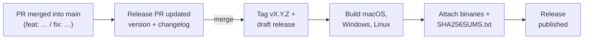

# Releases and release notes

## Where to find what's new

- **Release notes:** every release on the
  [Releases page](https://github.com/manimovassagh/Ferrodock/releases) lists
  what was added, fixed and changed.
- **Full history:** [CHANGELOG.md](https://github.com/manimovassagh/Ferrodock/blob/main/CHANGELOG.md).

## What a release contains

| File | For |
|---|---|
| `Ferrodock-<version>-macos-universal.zip` | macOS 11+, Apple Silicon and Intel |
| `Ferrodock-<version>-windows-x64.zip` | Windows 10/11 |
| `Ferrodock-<version>-linux-x64.tar.gz` | Linux x64 |
| `SHA256SUMS.txt` | Checksums of all of the above |

### Verifying a download

Run this in the folder you downloaded to:

```bash
shasum -a 256 -c SHA256SUMS.txt --ignore-missing   # macOS
sha256sum -c SHA256SUMS.txt --ignore-missing       # Linux
```

On Windows, run `Get-FileHash .\Ferrodock-<version>-windows-x64.zip` in
PowerShell and compare the hash with the line in `SHA256SUMS.txt`.

## Version numbers

Ferrodock follows [Semantic Versioning](https://semver.org):

| Change | Before 1.0 | From 1.0 |
|---|---|---|
| Bug fixes | patch (0.3.0 → 0.3.1) | patch (1.2.0 → 1.2.1) |
| New features | minor (0.3.1 → 0.4.0) | minor (1.2.1 → 1.3.0) |
| Breaking changes | minor, marked **breaking** | major (1.3.0 → 2.0.0) |

**Pre-releases** such as `1.0.0-rc.1` are marked as pre-releases on GitHub,
and are never shown as the latest version.

## How a release is made

Releases are automated with [release-plz](https://release-plz.dev) and
GitHub Actions:



1. Pull requests are squash-merged with
   [Conventional Commit](https://www.conventionalcommits.org) titles
   (`feat: …`, `fix: …`). The title becomes the changelog entry.
2. release-plz keeps a **release PR** open with the next version and its
   changelog.
3. Merging it tags the release and creates a draft. Every platform is
   built, the binaries and checksums are attached, and only then is the
   release published.

Maintainers: see
[RELEASING.md](https://github.com/manimovassagh/Ferrodock/blob/main/RELEASING.md)
for pre-releases and rebuilding a release's downloads.
